# ha-ups-card

[](https://www.home-assistant.io/integrations/marketplace/)
[](https://github.com/juju35/ha-ups-card/actions/workflows/hacs.yml)
[](https://github.com/juju35/ha-ups-card/actions/workflows/validate.yml)
[](https://github.com/juju35/ha-ups-card/actions/workflows/lint.yml)
[](https://github.com/juju35/ha-ups-card/releases/latest)
[](https://github.com/juju35/ha-ups-card/blob/main/LICENSE)
[](https://buymeacoffee.com/julienstep9)

<p align="center"></p>

<p align="center">
  &nbsp;&nbsp;
  
</p>

Lovelace cards for Home Assistant to keep an eye on your **UPS** (uninterruptible power supply): whether it runs on the mains or on battery, battery charge and runtime left, load and power, input and output voltages, temperature, the **power outages** of the last days and when the **battery** should be replaced, with an alert as soon as the UPS switches to battery.

The cards work on top of [Network UPS Tools (NUT)](https://www.home-assistant.io/integrations/nut/), first of all, and [APC UPS Daemon](https://www.home-assistant.io/integrations/apcupsd/): their entities are **discovered automatically** from the Home Assistant registries, whatever your language or entity ids. Any other UPS works with **generic sensors** (template, SNMP, Modbus, MQTT…) given in the card options.

[](https://my.home-assistant.io/redirect/marketplace_repository/?owner=juju35&repository=ha-ups-card&category=plugin)

|  Network UPS Tools |  APC UPS Daemon |
|---|---|
| 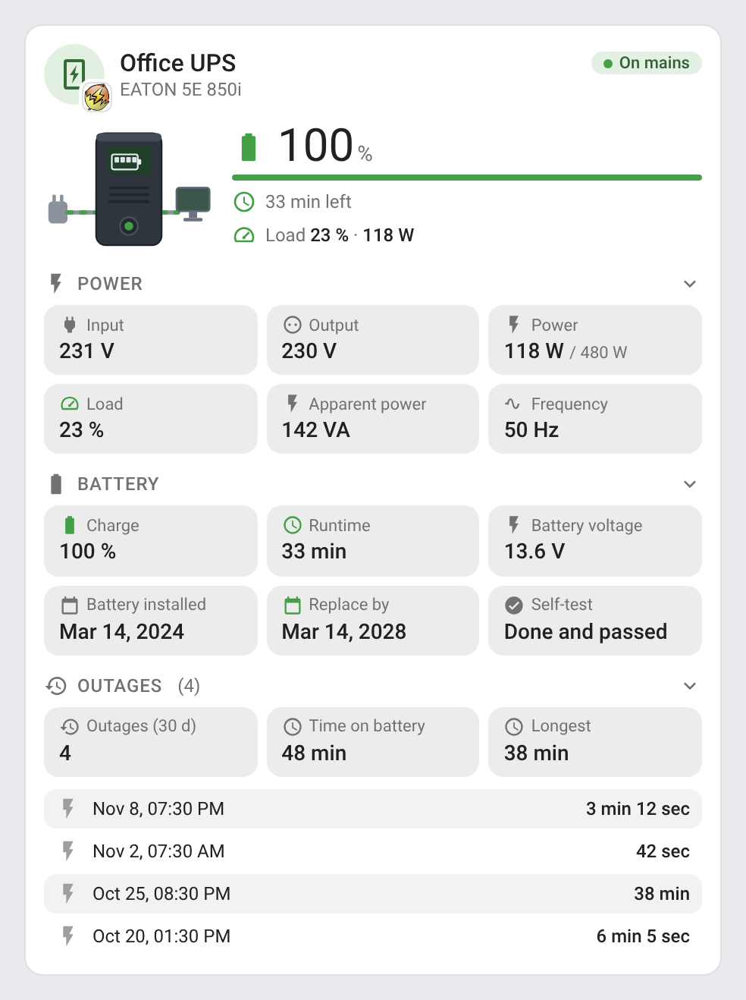 | 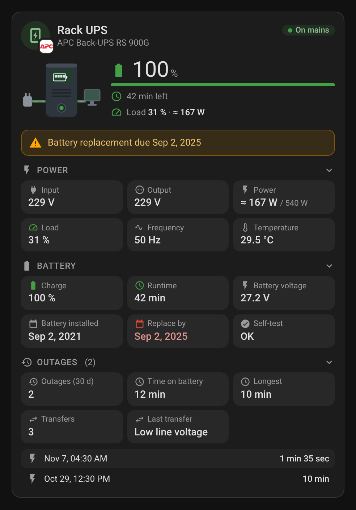 |
| 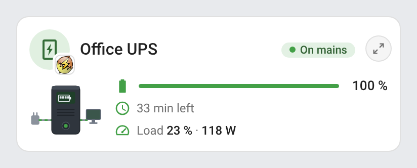 | 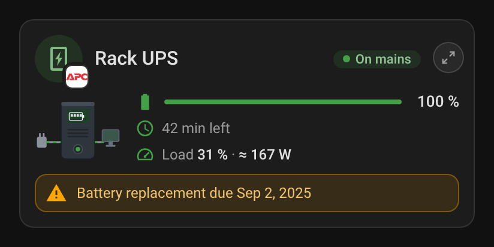 |

## Features

- Two cards: a full **UPS Card** (`custom:ups-card`) and a compact **UPS Mini Card** (`custom:ups-mini-card`)
- State of the UPS — on mains, charging, on battery, low battery, overload, bypass, calibration, battery test, forced shutdown, offline — as a status chip and as the color of the header icon (green on the mains, blue charging, orange on battery, red when low, overloaded or offline)
- A drawn UPS **animated by its state**: power flowing from the wall plug to the computer, the battery gauge filling while charging, the plug cut off and the gauge draining on battery, a blinking LED when something is wrong, the UPS shaking when overloaded (see [Animations](#animations))
- Battery charge, runtime left (in the units of your language), load in percent and power
- **Power** section: input and output voltage, real power against the nominal power, apparent power against the VA rating (both estimated from the load when the UPS does not report them), load, frequency, temperature
- **Battery** section: charge, runtime, battery voltage and temperature, date the battery was installed, date it should be replaced (`battery_life`, 4 years by default), result of the last self-test
- **Outage history** from the Home Assistant history: number of outages and time on battery over the last `history_days` days, the longest one and the latest ones with their date and duration, the one going on included; the transfers counted by APC UPS Daemon and the reason of its last transfer
- **Alerts**: on battery (for how long and the runtime left), low battery, overload, high load, battery to replace (flag of the UPS or replacement date reached), no communication with the UPS, UPS output off, no battery, alarm raised by the UPS, forced shutdown
- Collapsible sections (chevron to the right when folded, down when unfolded), folded back as they were by a click anywhere else
- Detail button on the mini card (top right): it switches the mini card to the full card's content and back; a click anywhere outside the card brings the compact view back
- Click any value to open its Home Assistant history (more-info dialog)
- Visual editor in the dashboard UI for both cards (no YAML needed)
- Sections view: the full card takes 12 columns by default and at least 6, the mini card 6; narrow widths get their own layout
- Light and dark mode, `prefers-reduced-motion`, English, French, German, Spanish, Italian, Dutch, European Portuguese, Polish, Serbian (Cyrillic and Latin), Romanian, Danish, Swedish, Bulgarian, Russian, Ukrainian, Hungarian, Slovak, Czech, Slovenian, Latvian and Greek
- Single file, no external dependency, the logos are embedded

## Supported integrations

| Integration | What the cards read |
|---|---|
|  [Network UPS Tools](https://www.home-assistant.io/integrations/nut/) (core, `nut`) | Status (`ups.status` and its readable form), battery charge, runtime, load, input and output voltage, real power and nominal power, apparent power and nominal apparent power, UPS and battery temperature, battery voltage, input frequency, battery date (or manufacturing date), self-test result, low battery threshold |
|  [APC UPS Daemon](https://www.home-assistant.io/integrations/apcupsd/) (core, `apcupsd`) | Status and online status, battery charge, time left, load, line and output voltage, nominal output power and nominal apparent power (power estimated from the load), internal temperature, battery voltage, line frequency, battery replacement date, self-test result, transfer count, last transfer reason, time on battery, time of the last transfer from battery |
| Generic sensors | Any sensor given in the `entities` option: status (text), mains binary sensor, battery, runtime, load, voltages, power, temperature, battery voltage, frequency, battery date (see [Generic sensors](#generic-sensors)) |

Many sensors are **disabled by default** in Home Assistant — for NUT the runtime, real and apparent power and their nominal values, temperatures, battery voltage and date, input frequency, self-test result and low battery threshold; for apcupsd the last transfer reason and the manufacturing date: enable the ones you want in the device page of the UPS, the cards show them as soon as they are there. Details in [How it works](#how-it-works).

## Prerequisites

Home Assistant 2024.8 or later, with the Network UPS Tools or APC UPS Daemon integration configured, or sensors of your own for the UPS. The outage history needs the [Recorder](https://www.home-assistant.io/integrations/recorder/) (on by default).

## Installation

### Via the Marketplace (recommended)

Click the button below to add the repository directly:

[](https://my.home-assistant.io/redirect/marketplace_repository/?owner=juju35&repository=ha-ups-card&category=plugin)

Then click **Install**, and reload your browser when the Marketplace asks you to.

Or manually:

1. Open **Settings → Marketplace → Add from link** (top right; this needs a GitHub account connected)
2. Add `https://github.com/juju35/ha-ups-card` — Type: **Dashboard**
3. Open **UPS Card** and click **Install**
4. Clear your browser cache and refresh

The Marketplace adds the resource `/local/community/ha-ups-card/ups-card.js` for you.

### Manual

1. Download `ups-card.js` and the `ups-card.i18n.*.js` translation files from the [latest release](https://github.com/juju35/ha-ups-card/releases/latest)
2. Copy them all to `/config/www/` (without the translation files, the cards show in English)
3. Go to **Settings → Dashboards → ⋮ → Resources** → Add resource:
   - URL: `/local/ups-card.js`
   - Type: **JavaScript Module**
4. Clear your browser cache and refresh

## Configuration

### Card types

| Card | Type |
|---|---|
| UPS Card | `custom:ups-card` |
| UPS Mini Card | `custom:ups-mini-card` |

### Visual editor

Edit a dashboard, click **Add card** and search for **UPS Card** or **UPS Mini Card**. The first UPS is preselected; pick another one in the list if you have several (or **None** for generic sensors only), set an optional title, choose the sections, the folded sections, the history length and the battery life, and fill the **Entities** part for generic sensors. The preview updates live, and options left at their default are kept out of the generated YAML.

### Minimal

```yaml
type: custom:ups-card
```

```yaml
type: custom:ups-mini-card
```

### Full options

```yaml
type: custom:ups-card
device: Office UPS
title: Office
show_title: true
show_subtitle: true
show_alerts: true
show_power: true
show_battery: true
show_outages: true
collapsed:
  - power
history_days: 30
max_outages: 5
low_runtime: 10
battery_life: 4
battery_replaced: "2024-03-14"
entities:
  temperature: sensor.office_ups_room_temperature
language: fr
```

```yaml
type: custom:ups-mini-card
device: Rack UPS
title: Rack
show_alerts: true
low_runtime: 10
zoom: true
language: fr
```

### Options reference

| Option | Card | Default | Description |
|---|---|---|---|
| `device` | both | First UPS | UPS to display: its device name (as shown in Home Assistant) or its device id (set by the visual editor). Leave it out with `entities` only for generic sensors |
| `entities` | both | — | Map of entities, see [Generic sensors](#generic-sensors). With `device`, each one replaces the integration's own |
| `title` | both | Device name | Card title |
| `show_title` | both | `true` | Show the title in the header (e.g. `false` under a section heading of your own) |
| `show_subtitle` | both | `true` | Show the brand and model under the title (full card) |
| `show_alerts` | both | `true` | Show the alerts (the mini card shows the most important one) |
| `low_runtime` | both | `10` | Runtime left, in minutes, under which the runtime turns red and a UPS on battery reads **Low battery** (orange under twice this value) |
| `zoom` | mini | `true` | Detail button at the top right of the mini card: it shows the full card's content (with the same options, so `show_power`, `collapsed`, `history_days`… can be set on the mini card too) and switches back; a click outside the card also brings the compact view back. `false` removes the button |
| `show_power` | full | `true` | Power section |
| `show_battery` | full | `true` | Battery section |
| `show_outages` | full | `true` | Outage history section |
| `collapsed` | full | `[]` | Sections folded by default, among `power`, `battery` and `outages`. Click a section title (or Tab to it and press Enter or Space) to fold or unfold it |
| `history_days` | full | `30` | Days of history read for the outages (1 to 365, within what the Recorder keeps: 10 days by default) |
| `max_outages` | full | `5` | Number of latest outages listed |
| `battery_life` | full | `4` | Years after which the battery should be replaced, counted from its installation date |
| `battery_replaced` | full | — | Date the battery was installed (`YYYY-MM-DD`), when the UPS does not report it or after you replaced it |
| `language` | both | Auto | Force language: `en`, `fr`, `de`, `es`, `it`, `nl`, `pt`, `pl`, `sr`, `sr-Latn`, `ro`, `da`, `sv`, `bg`, `ru`, `uk`, `hu`, `sk`, `cs`, `sl`, `lv` or `el` (auto-detects from HA settings) |

### Generic sensors

A UPS that neither integration knows (SNMP, Modbus, MQTT, a smart plug's battery pack, template sensors…) is shown from sensors given in `entities`:

```yaml
type: custom:ups-card
title: Garage UPS
entities:
  status: sensor.garage_ups_status
  battery: sensor.garage_ups_battery
  runtime: sensor.garage_ups_runtime
  load: sensor.garage_ups_load
  power: sensor.garage_ups_power
battery_replaced: "2025-06-01"
```

| Key | Entity |
|---|---|
| `status` | Status text: NUT codes (`OL`, `OB LB`, `OL CHRG`…), apcupsd words (`ONLINE`, `ONBATT`…) or plain words (`online`, `on battery`, `charging`, `overload`, `offline`…) |
| `online` | Binary sensor of the mains, `on` while the mains is there (used when there is no status) |
| `battery` | Battery charge, % |
| `runtime` | Runtime left, in seconds, minutes or hours (read from its unit) |
| `load` | Load, % |
| `input_voltage`, `output_voltage` | Voltages |
| `power` | Real power, W |
| `temperature` | Temperature |
| `battery_voltage` | Battery voltage |
| `frequency` | Input frequency |
| `battery_date` | Battery installation date (`YYYY-MM-DD`, `YYYY/MM/DD`, `MM/DD/YY`…) |

The outage history is read from the `status` entity, or from `online`.

## Screenshots

### Animations

The drawn UPS plays one animation per state and settles to a still picture when it is offline or unknown; every animation honours `prefers-reduced-motion`.

On the mains, green dashes of power flow from the wall plug through the UPS to the computer:

| Light | Dark |
|---|---|
| 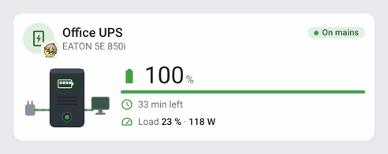 | 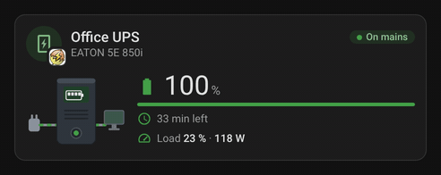 |

Charging, the flow turns blue and the next bar of the battery gauge fills on the screen:

| Light | Dark |
|---|---|
| 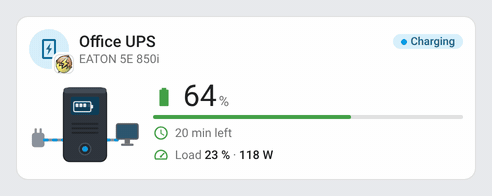 | 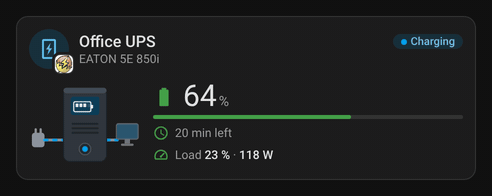 |

On battery, the plug is cut off with a spark, the flow slows down in orange, the last gauge bar drains and the LED blinks with waves, while the alert tells for how long and the runtime left:

| Dark | Light |
|---|---|
| 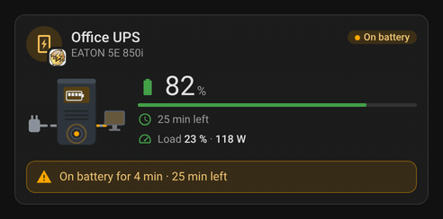 | 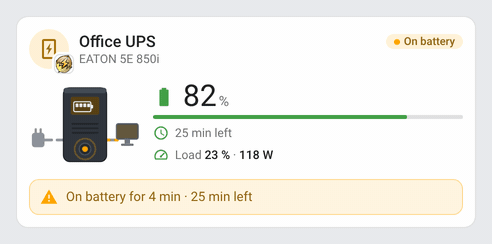 |

Low battery, everything turns red and blinks faster, the last gauge bar flashing:

| Dark | Light |
|---|---|
| 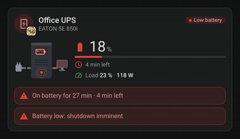 | 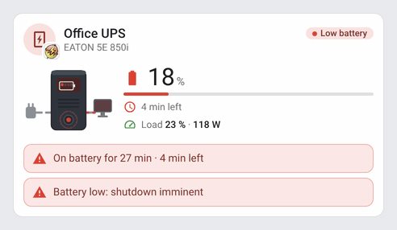 |

Overloaded, the UPS shakes and its flow and LED turn red:

| Light | Dark |
|---|---|
| 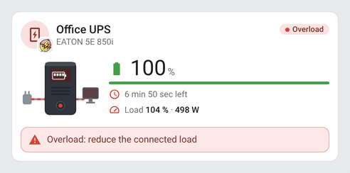 | 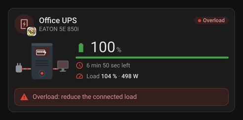 |

### Cards

The full card of a NUT UPS (Eaton 5E) and of an apcupsd one (APC Back-UPS), whose battery is past its replacement date; the transfers and the last transfer reason come from apcupsd:

| | Network UPS Tools | APC UPS Daemon |
|---|---|---|
| Light |  | 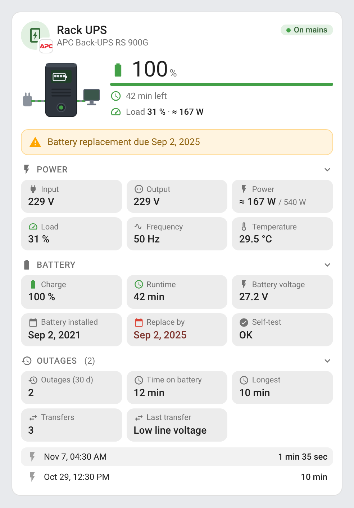 |
| Dark | 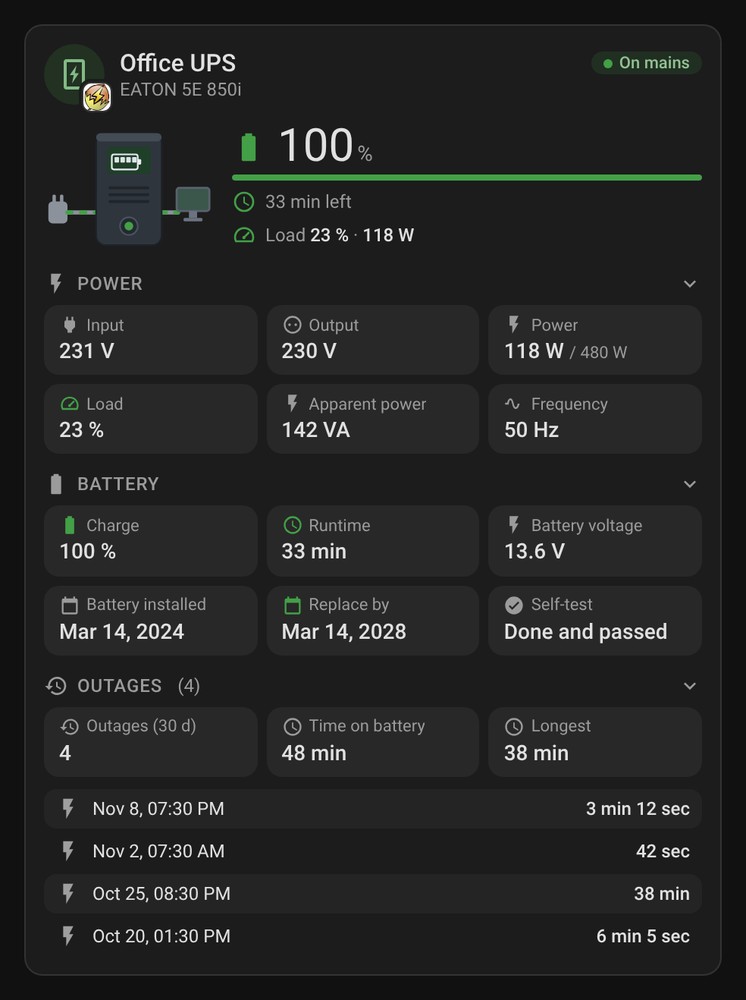 |  |

During an outage: the alert, the outage going on at the top of the history, the power and battery sections folded (`collapsed: [power, battery]`):

| Dark | Light |
|---|---|
| 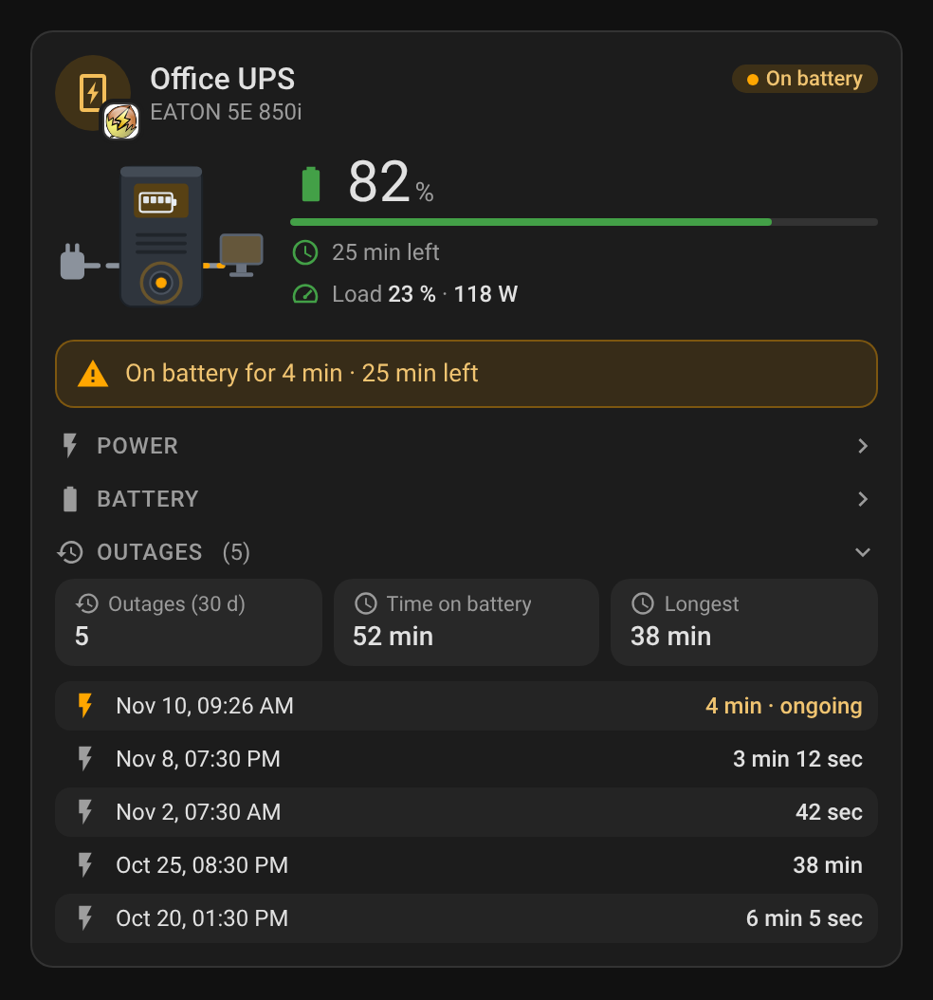 | 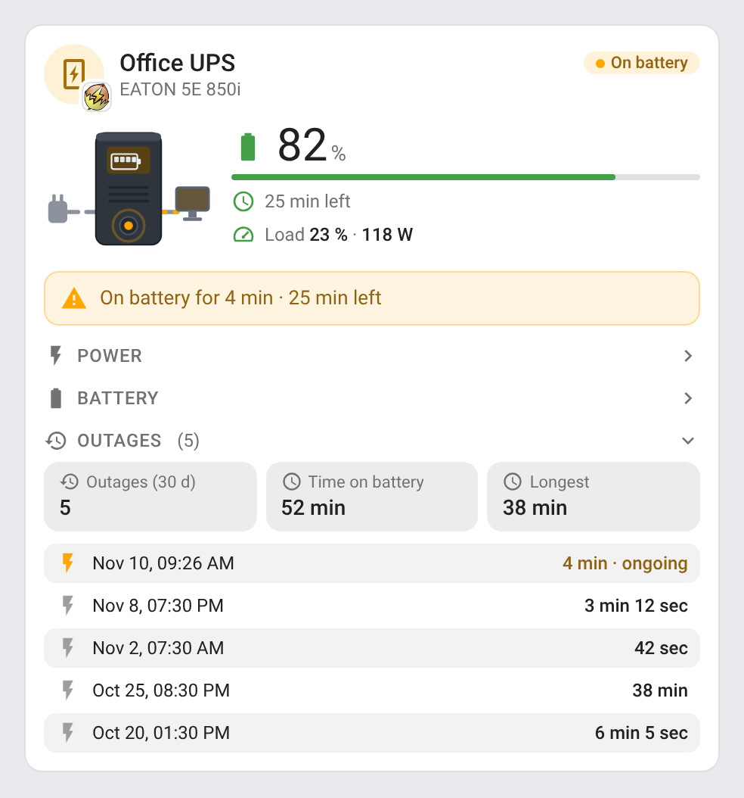 |

Generic sensors (a status text, battery, runtime, load and power) with `battery_replaced`; back on the mains 40 minutes ago after a 10-minute outage, the battery not full reads **Charging**:

| Light | Dark |
|---|---|
| 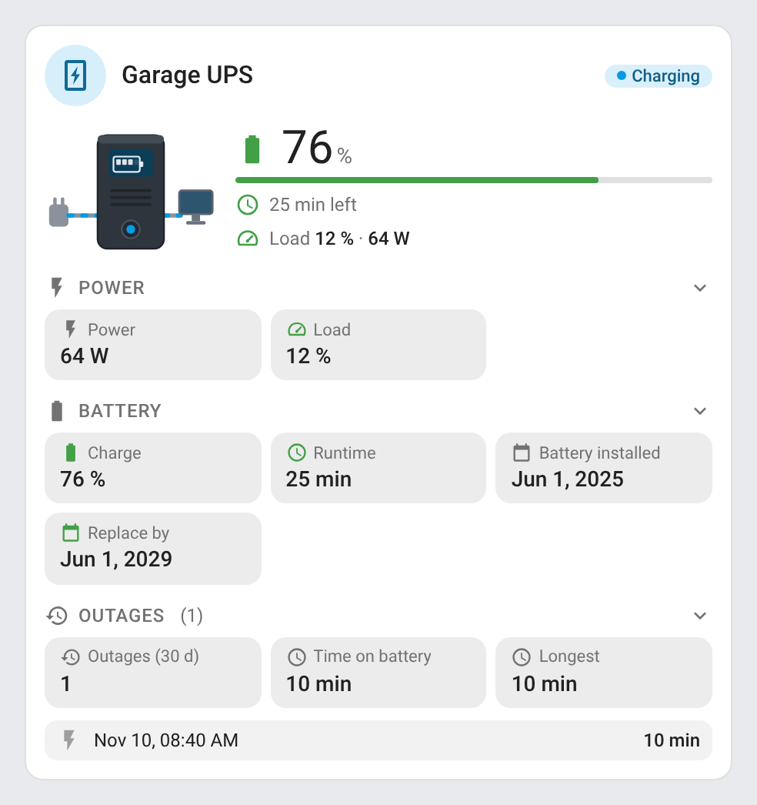 | 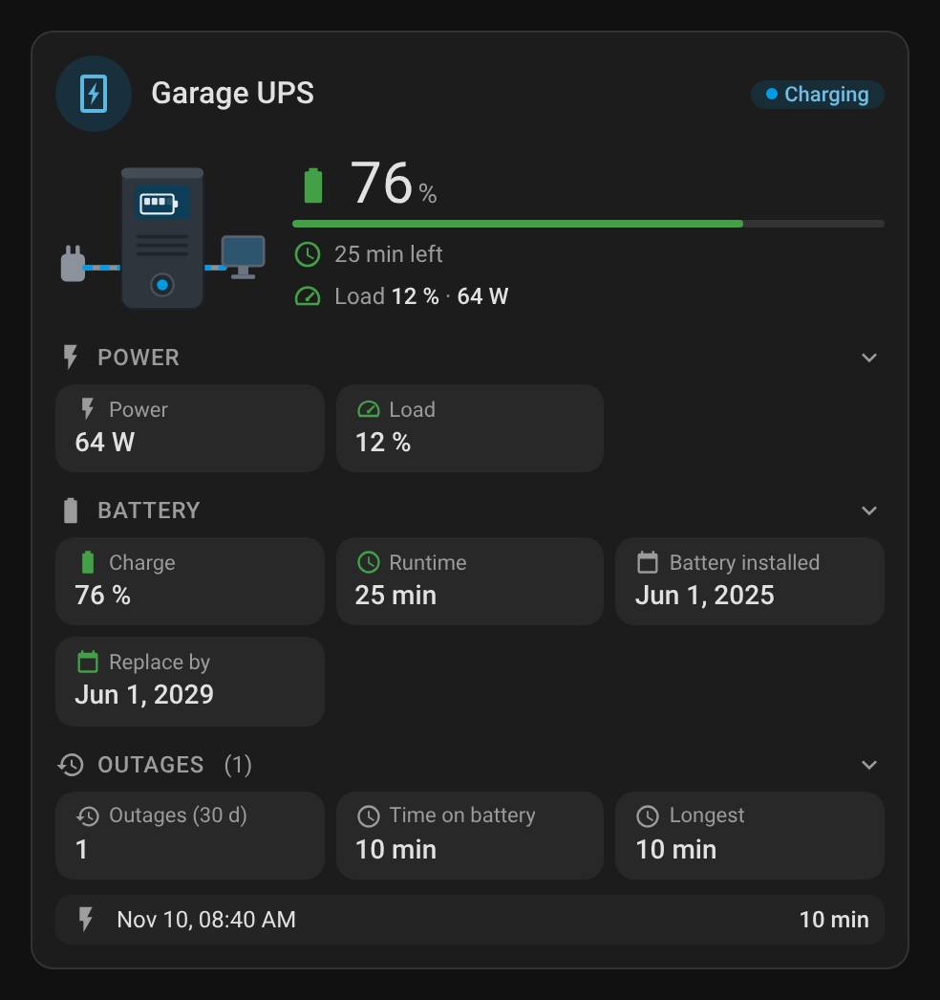 |

The mini card, and its detailed view after a click on the detail button:

| | Network UPS Tools | APC UPS Daemon |
|---|---|---|
| Light |  | 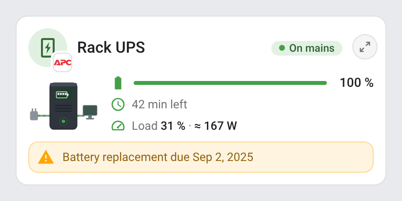 |
| Dark | 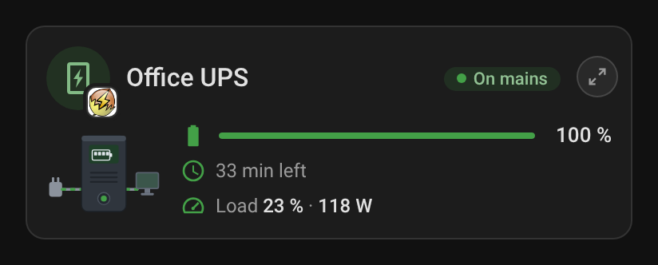 |  |

| Detail view, light | Detail view, dark |
|---|---|
| 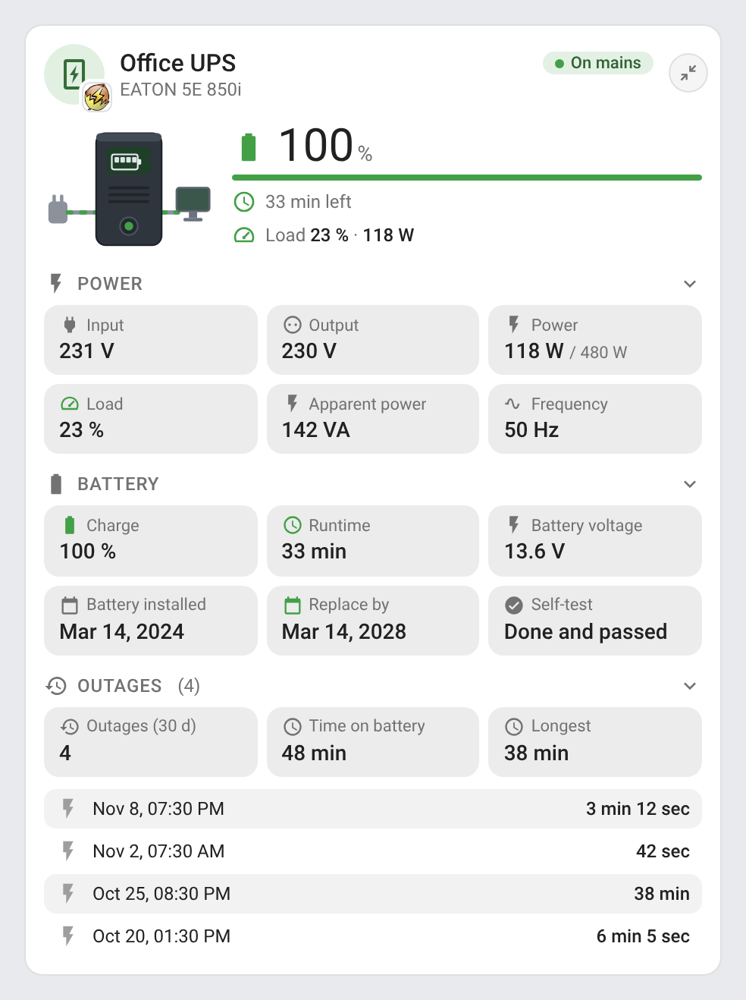 | 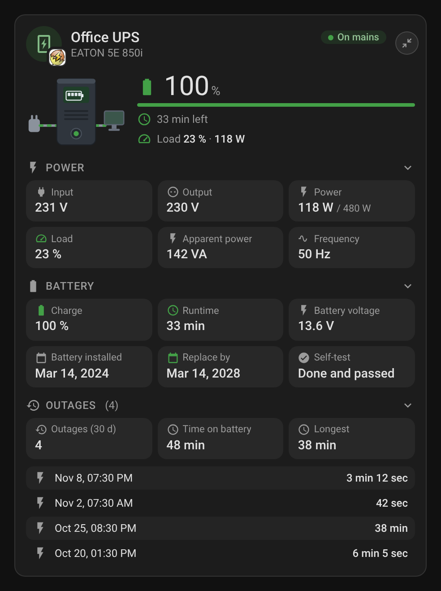 |

Narrow widths: the full card at 238 px (two tiles per row, the subtitle cut) and the mini card at 170 px (the picture gives way, the status chip keeps its dot):

| | Full card | Mini card |
|---|---|---|
| Light | 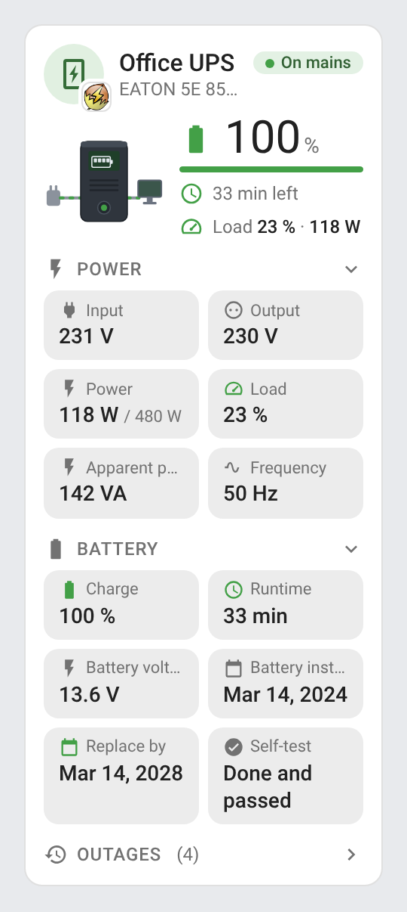 | 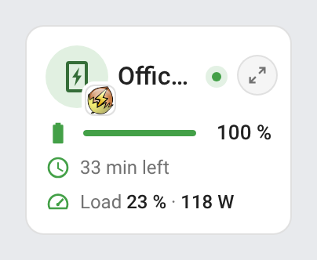 |
| Dark | 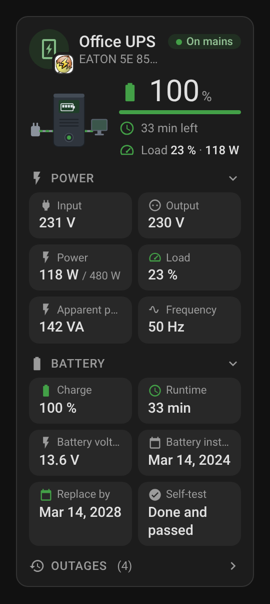 | 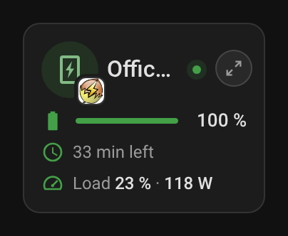 |

## How it works

The cards read the Home Assistant entity and device registries instead of entity ids: every sensor of the NUT and apcupsd integrations is matched by its `translation_key` (`ups_status`, `battery_runtime`, `time_left`, `line_voltage`…) — or its device class when it has none (the NUT apparent power, the apcupsd battery charge) — and by the UPS device it belongs to. The apcupsd keys are mapped onto the NUT ones, so the same card reads both. Entity ids can therefore be in any language or renamed.

### State

The state comes from the raw NUT status (`OL`, `OB`, `LB`, `CHRG`, `OVER`, `BYPASS`, `CAL`, `TEST`, `FSD`, `OFF`, `RB`…), else its readable form, the apcupsd status (`ONLINE`, `ONBATT`, `LOWBATT`, `OVERLOAD`, `COMMLOST`, `SHUTTING DOWN`, `REPLACEBATT`…) or the words of a generic sensor, else the mains binary sensor. A UPS on battery reads **Low battery** when the UPS says so, when its charge is under its own low threshold (NUT `battery.charge.low`, 20 % otherwise) or when its runtime is under `low_runtime`. A runtime calibration or a battery test (`CAL`, `TEST`) reads as such, not as an outage, even though the UPS runs on battery. apcupsd and generic sensors do not report charging: a battery under 100 % on the mains reads **Charging** for 12 hours after the mains came back (apcupsd's time of the last transfer from battery, else the end of the latest outage of the history, else the last change of the status), then **On mains** — a battery that settles below 100 % does not read Charging forever. An unavailable status, `COMMLOST` or NUT `OFF` (the UPS output is off, with its own alert) read **Offline**.

| State | Color |
|---|---|
| On mains | green |
| Charging, calibrating, battery test | blue |
| On battery, bypass | orange |
| Low battery, overload, forced shutdown, offline | red |

### Power and battery

The power is the UPS's real power sensor (NUT `ups.realpower`), else the load times the nominal power (NUT `ups.realpower.nominal`, apcupsd nominal output power), shown with "≈"; the same goes for the apparent power (NUT `ups.power`, else the load times NUT `ups.power.nominal` or apcupsd nominal apparent power). When there is no real power at all, the hero line shows the apparent power. The load turns orange at 75 % and red at 90 % (with a **High load** alert). The battery charge turns orange at 50 % and red under the low threshold.

The battery installation date is `battery_replaced`, else the UPS's battery date (NUT `battery.date`, apcupsd `BATTDATE`), else its battery manufacturing date. The replacement date is `battery_life` years later: orange (and an alert) within 90 days of it, red once passed. A UPS reporting that its battery needs replacing (`RB`, `REPLACEBATT`) gets a red alert whatever the date.

### Outage history

The card reads the history of the status entity (`history/history_during_period`, the last `history_days` days, states only) when it is shown, again when the status changes and every 15 minutes, and counts the stretches on battery — an overload or a forced shutdown on battery included, a calibration or a battery test left out, a lost communication in the middle of an outage not splitting it: their number, the total time on battery, the longest one and the latest `max_outages` ones with their start and duration; an outage going on is listed first with **ongoing**. The history only goes back as far as the Recorder keeps it (`purge_keep_days`, 10 days by default). The mini card reads it only in its detailed view.

## Development

```bash
npm install
npm run build        # bundles src/ups-card.js + the logos of images/ into dist/ups-card.js (translations split into dist/ups-card.i18n.*.js)
npm run check        # builds and checks the card (run in CI)
npm test             # unit tests (node --test)
npm run screenshots  # renders the cards (and one GIF per animated state, needs ffmpeg) with mock data into screenshots/
```

`dist/` is not committed: `npm run build` creates it locally, CI builds it on every push, and the release workflow attaches the built files to the release, which is where the Marketplace installs it from. The **Screenshots** workflow re-renders the captures on every pull request that touches the card and commits them to the pull request's branch when a pixel changed.

### Releasing

1. Bump `version` in `package.json` (and `package-lock.json` with `npm install`)
2. Add a `## <version>` section at the top of [CHANGELOG.md](https://github.com/juju35/ha-ups-card/blob/main/CHANGELOG.md)
3. Push to `main`: the **Release** workflow builds the card, creates the tag and the GitHub release with the changelog section as notes, and attaches `ups-card.js` and its translation files

## Translations

The cards auto-detect the language from your Home Assistant settings. Currently supported:

| Language | Code |
|---|---|
| English | `en` |
| Français | `fr` |
| Deutsch | `de` |
| Español | `es` |
| Italiano | `it` |
| Nederlands | `nl` |
| Português (European; also used for `pt-BR`) | `pt` |
| Polski | `pl` |
| Српски | `sr` |
| Srpski (latinica) | `sr-Latn` |
| Română | `ro` |
| Dansk | `da` |
| Svenska | `sv` |
| Български | `bg` |
| Русский | `ru` |
| Українська | `uk` |
| Magyar | `hu` |
| Slovenčina | `sk` |
| Čeština | `cs` |
| Slovenščina | `sl` |
| Latviešu | `lv` |
| Ελληνικά | `el` |

Contributions for additional languages are welcome!

## Credits

The Network UPS Tools and APC logos come from the [Home Assistant brands](https://github.com/home-assistant/brands) repository; APC is a trademark of Schneider Electric. This project is not affiliated with the Network UPS Tools project, apcupsd, APC or Schneider Electric.

## License

[MIT](https://github.com/juju35/ha-ups-card/blob/main/LICENSE)

## Support

If you find this project useful, you can support its development:

<a href="https://buymeacoffee.com/julienstep9"></a>
